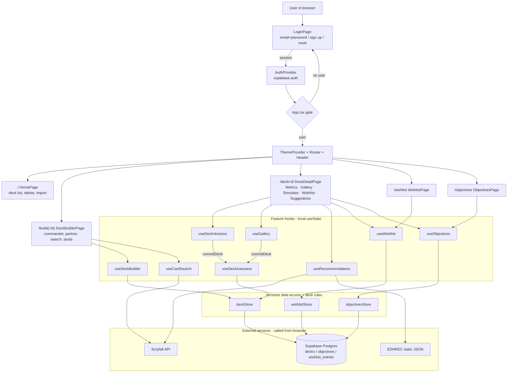

# MTG Deck Analyzer Documentation Implementation Plan

> **For agentic workers:** REQUIRED SUB-SKILL: Use diataxis:subagent-driven-development (recommended) or diataxis:executing-plans to implement this plan task-by-task. Steps use checkbox (`- [ ]`) syntax for tracking.

---

## Project Summary

- **What it is:** a browser-only React 19 + TypeScript SPA for building and tuning Magic: The Gathering **Commander (EDH)** decks. Personal tool for a handful of users, not a public product.
- **Users:** (1) deck builders who sign in and use the app; (2) the product owner/maintainer and AI coding agents who modify it.
- **Core concepts:** Deck (commander + optional partner + up to 99 cards, color-identity legal, singleton), **Version** (a named set of card swaps + per-card objective overrides layered on the main deck), **Strategy** (`Deck.objectives`, the deck's 1–2 plans), **Objectives** (user-defined per-card tags), **Card Roles** (ramp/draw/removal… auto-detected from rules text, never stored), **Wishlist** (cross-deck cards to acquire), **Suggestions** (EDHREC + Scryfall recommendations), **Hand Simulator** (draw, play lands, cast).
- **Core workflows:** sign in → create deck (pick commander, search/add cards, basic lands, or import JSON) → open deck detail → read Metrics → tag cards in Gallery → stage swaps → save/compare/promote Versions → use Suggestions, Wishlist, Simulator → export (JSON/TXT/XLSX).

## System Architecture Summary

- **Runtime:** static Vite build (SPA, `vercel.json` rewrites all paths to `index.html`). No custom server. The browser talks directly to Supabase (Auth + Postgres tables `decks`, `objectives`, `wishlist_entries`), Scryfall REST (unauthenticated, 2 req/s limit on search/collection), and EDHREC static JSON (unofficial).
- **Shell:** `main.tsx` → `AuthProvider` → `App.tsx` all-or-nothing auth gate (spinner / `LoginPage` / app). App = `ThemeProvider` + `BrowserRouter` + `ErrorBoundary` + global `Header` + 6 flat routes: `/`, `/build`, `/build/:deckId`, `/deck/:deckId` (tabs: Metrics, Gallery, Simulator, Deck Wishlist, Suggestions), `/wishlist`, `/objectives`.
- **Layers:** pages → per-feature hooks (`useDeckBuilder`, `useDeckVersions`, `useGallery`, `useWishlist`, `useObjectives`, `useRecommendations`, `useCardSearch`) → `src/store/*` data-access modules (Supabase CRUD; `deckStore` also holds pure deck rules + import/export). No global client store or query cache.
- **Write paths:** whole-deck writes serialized through `useDeckAutosave` (status + Retry); row-level writes are optimistic with rollback.
- **Extension points:** new feature folder under `src/features/<name>/` (components/hooks/utils); new store module; new daisyUI theme in `src/index.css` + Header list; new recognized objective presets (`recognizedObjectives.ts`); recommendation signals (`deckSignals.ts`, `blend.ts`).



## Toolchain Detection

- **Docs toolchain:** none. Plain Markdown in the repo (`README.md`, `CLAUDE.md`, `IDEAS.md`, `docs/`, `tasks/`), read on GitHub/in-editor. **Decision: keep plain Markdown under `docs/`, with `docs/README.md` as the navigation hub. Do not add MkDocs/Docusaurus** (YAGNI for a handful of users).
- **Build/dev:** Vite 8, `npm run dev | build (tsc -b && vite build) | lint | preview`. Path alias `@/*` → `src/*`. Env vars `VITE_SUPABASE_URL`, `VITE_SUPABASE_ANON_KEY` in `.env.local` (app throws "Missing Supabase environment variables" without them).
- **Quality gates:** ESLint 9 flat config; husky `pre-commit` → lint-staged (`eslint --max-warnings=0` on `src/**/*.{ts,tsx}`, `tsc -p tsconfig.app.json --noEmit`). Markdown-only commits skip both.
- **Tests:** none configured (planned in `tasks/009`). Docs must not tell anyone to run `npm test`.
- **Deploy:** Vercel SPA (`vercel.json` rewrite). Deploys are **manual** (`vercel --prod` or the Vercel dashboard), not triggered by pushes — confirmed by the product owner 2026-11-20.
- **Node:** Node 22 LTS — confirmed by the product owner 2026-11-20.
- **Stray:** `preview_import_groups.js` at repo root (one-off import-grouping script, not part of the build).

## Existing Documentation

### Catalogue

```text
File: README.md
Purpose: Unmodified Vite "React + TypeScript + Vite" template boilerplate; says nothing about this app.
Classification: Mixed (none of the four; misleading Home page)

File: CLAUDE.md
Purpose: Agent instructions: app overview, commands, architecture, mutation conventions, styling rules, scope guidance, where docs go.
Classification: Mixed (explanation + reference + how-to; audience is AI agents)

File: IDEAS.md
Purpose: Product owner's feature/bug backlog.
Classification: Not documentation (backlog). Out of scope; do not modify.

File: docs/design-tokens.md
Purpose: Breakpoints, type scale, z-index scale, with audit of current violations and enforcement notes.
Classification: Reference (with embedded decision rationale and an audit snapshot)

File: docs/plans/README.md
Purpose: Explains what docs/plans/ is for.
Classification: Reference (folder readme)

File: docs/plans/card-recommendations-v2.md
Purpose: Brief and phased build plan for EDHREC-aware suggestions; contains the best description of how suggestions work.
Classification: Mixed (explanation + implementation plan). Engineering working doc.

File: docs/plans/simulator-playability-roadmap.md
Purpose: Roadmap for the hand simulator with per-phase status; contains the only description of current simulator capabilities.
Classification: Mixed (explanation + plan + status). Engineering working doc.

File: tasks/README.md, tasks/001–024-*.md
Purpose: Issue-style index and write-ups of scoped engineering work.
Classification: Not documentation (issue tracker). Out of scope; do not modify except to link.
```

### Structural problems

- **No Home page.** `README.md` is template boilerplate. There is no entry point for users or new contributors.
- **No user documentation at all.** Nothing tells a deck builder how to build, version, tag, import/export, or use suggestions or the simulator.
- **No tutorials or learning path.** Onboarding knowledge exists only in source code and agent instructions.
- **Architecture explanation lives only in `CLAUDE.md`.** It is written for agents and mixed with rules and commands. Human contributors have no explanation page, and a second copy would duplicate it unless `CLAUDE.md` links out.
- **Current-behaviour explanation is buried in plans.** How suggestions and the simulator work today is mixed with future phases in `docs/plans/`. Plans go stale as phases land.
- **No reference for public interfaces.** There's no doc for the deck JSON import/export format, deck-legality rules, data model, env vars, or external service limits.
- **Contributor setup is undocumented.** `.env.local` and its variable names, the pre-commit gates, and the no-test-runner rule are recorded only in `CLAUDE.md`.
- **Navigation.** `docs/` mixes one reference file with a working-docs folder, and nothing indexes it.


## Documentation Architecture

### Vision

The docs serve two small audiences. **Deck builders** (the app's few signed-in users) need to go from first sign-in to a legal, tuned Commander deck. To get there they must understand Strategy vs. Objectives vs. Card Roles and how Versions layer over a deck. **Contributors** (the product owner and AI agents) need to set up, understand the browser-only architecture and its write conventions, and change the app without breaking those conventions. The docs describe the app as it is today. Future work stays in `IDEAS.md`, `tasks/`, and `docs/plans/`.

### Top-level navigation

Plain Markdown. `docs/README.md` is the hub, and the repo `README.md` is the front door that links to it.

```text
Section: Home
Purpose: Say what the app is and route each audience to its starting page.
Contains: README.md (front door), docs/README.md (hub/index)
Excludes: Instructions, architecture detail, backlog items

Section: Tutorials (Getting Started)
Purpose: Guided first successes for a new deck builder.
Contains: Step-by-step lessons with a concrete example deck
Excludes: Option lists, edge cases, rationale beyond a sentence

Section: How-to Guides
Purpose: Task recipes for competent users, grouped by goal.
Contains: "Using the app" guides and "Developing" guides
Excludes: Teaching from zero, full option catalogues, design rationale

Section: Reference
Purpose: Neutral, complete descriptions of the app's surfaces and rules.
Contains: Screens/tabs, deck rules, deck file format, data model, configuration & commands, external services, Card Roles, design tokens
Excludes: Procedures, opinions

Section: Explanation
Purpose: Mental model and the reasons behind the design.
Contains: Domain concepts (Strategy/Objectives/Roles, Versions, Suggestions) and Architecture (system design, write conventions)
Excludes: Steps, exhaustive field lists

Section: Contributing
Purpose: Get a contributor productive and keep changes consistent.
Contains: Development setup, conventions & workflow, where docs/plans go
Excludes: Architecture narrative (link to Explanation), backlog

Section: Troubleshooting
Purpose: Symptom → cause → fix for user and dev errors.
Contains: One page with user and developer sections
Excludes: Bug backlog (that is IDEAS.md / tasks)
```

Architecture lives under Explanation and Troubleshooting is a single page, both because the app is small. There is no About section, because Home covers it.

### Learning architecture

- **First page:** `README.md` → `docs/README.md` → "Build your first Commander deck".
- **First success:** a saved, legal deck with a commander, about 10 cards, and basic lands, open on the Metrics tab.
- **Tutorial order:** (1) Build your first Commander deck → (2) Tune a deck with objectives and versions.
- **Explanation support:** tutorial 2 links to "Strategy, Objectives, and Card Roles" and "How deck versions work" where those terms first appear, without explaining them inline.
- **Redirects out:** tutorial 1 → Deck rules (reference), Import and export (how-to). Tutorial 2 → Manage deck versions, Tag cards (how-to), Screens reference.

### Task architecture

```text
Task group: Build and maintain decks
User goal: Get cards into a legal deck and move decks in and out of the app
Likely documents: Import and export a deck; Set up partner commanders
Related reference: Deck rules; Deck file format; Screens and tabs
Related explanation: Strategy, Objectives, and Card Roles

Task group: Tune and compare
User goal: Try changes without losing the main list; use tags and suggestions
Likely documents: Manage deck versions; Tag cards and set a deck strategy; Get card suggestions; Test opening hands
Related reference: Screens and tabs; Card Roles
Related explanation: How deck versions work; How suggestions are chosen

Task group: Track cards to acquire
User goal: Keep a wishlist linked to decks
Likely documents: Use the wishlist
Related reference: Screens and tabs
Related explanation: —

Task group: Develop the app
User goal: Make a correct change that fits the conventions
Likely documents: Add a data write (mutation); Call Scryfall without hitting rate limits; Add a daisyUI theme
Related reference: Data model; Configuration and commands; External services; Design tokens
Related explanation: Architecture overview
```

### Conceptual architecture

- **Domain concepts (users):**
  - Commander deck structure and color identity.
  - **Strategy vs. Objectives vs. Card Roles**, the concept users confuse most (`tasks/023`).
  - **Versions** as diffs over the main deck (swaps plus objective overrides), and promote-to-main.
  - **Suggestions**: EDHREC co-play data blended with deck signals, each shown with its reasons.
- **Architectural ideas (contributors):**
  - The app runs entirely in the browser, with no server.
  - Stores are data-access modules, not state stores.
  - Each feature has its own hooks, with no shared cache.
  - Auth is an all-or-nothing gate.
  - External services each have limits.
- **Design decisions to explain:**
  - Why whole-deck writes are serialized through `useDeckAutosave` while row writes are optimistic.
  - Why Card Roles are detected, never stored.
  - Why the app deliberately stays small (no query layer, no global store).
- **Relationships:**
  - A Deck has entries, a Strategy, and Versions.
  - Entries carry Objective ids.
  - Versions override entries and objectives.
  - Card Roles are derived from entries.
  - Suggestions read the deck, its Strategy, Objectives, and Roles.

### Reference architecture

The reference mirrors the app's public surfaces. There is no public API or CLI.

- **UI surface:** routes, Deck Detail tabs, and what each control does.
- **Domain rules:** legality, singleton exemptions, partners, card count.
- **File formats:** the deck JSON import/export schema, plus the TXT and XLSX export layouts.
- **Data model:** domain types (`src/types/index.ts`) and how they map to the three Supabase tables. Derive this from code only and never query the database.
- **Configuration:** env vars, npm scripts, the path alias, pre-commit gates.
- **External services:** Scryfall endpoints and rate limits, EDHREC endpoints, Supabase Auth methods.
- **Card Roles:** the detected roles and what triggers each one.
- **Design tokens:** the existing `docs/design-tokens.md`.

### Contributor and developer architecture

- **Development setup:** Node/npm, `.env.local` with the two `VITE_` vars, `npm run dev`. Never commit or print credentials.
- **Repository structure:** pages / features / store / hooks / components / context. Link to the Architecture overview instead of repeating it.
- **Testing:** there are no automated tests today. Verify with `npm run lint`, `npm run build`, and a manual browser check that includes a 375px phone width. `tasks/009` covers the future test setup.
- **Build and release:** build with `npm run build`, preview with `npm run preview`. Hosting is a Vercel SPA (product owner still needs to confirm).
- **Conventions:** mutation patterns, text-size rules, lucide icons, daisyUI tokens, task checkboxes. Link to `CLAUDE.md` for the agent-specific rules.
- **Docs conventions:** which Diátaxis section a page belongs in, where tasks, plans, and ideas go, and keeping `docs/README.md` up to date.

### Structural issues to resolve

- **Replace:** `README.md` boilerplate becomes the real front door.
- **Reuse:** `docs/design-tokens.md` already fits as reference. Move it to `docs/reference/` and update every inbound link.
- **Extract:** pull the descriptions of current behavior out of `docs/plans/card-recommendations-v2.md` and `simulator-playability-roadmap.md` into explanation and how-to pages. The plans stay as working docs.
- **De-duplicate:** `CLAUDE.md`'s architecture narrative moves to `docs/explanation/architecture.md`. `CLAUDE.md` keeps its agent rules and links out. Trimming it needs product-owner sign-off.
- **Leave alone:** `IDEAS.md`, `tasks/`, and `docs/plans/` stay outside the Diátaxis tree. The hub links to them under "Project working docs".
- **Missing:** tutorials, how-tos, most reference pages, contributing, and troubleshooting.

## Documentation Plan

### Ground rules for whoever executes this plan

- **Source of truth is the code on the current branch.** Before you write any claim, open the cited source files and confirm it. Don't copy facts from this plan, `CLAUDE.md`, or `docs/plans/` without checking them. Those can be stale.
- **Database is off-limits.** Derive the data model from `src/store/*.ts` and `src/types/index.ts` only. Never query Supabase. Never print the values in `.env.local`.
- **Document today's behavior only.** If a feature is partial (for example simulator stats or token suggestions), say what it does now and link the relevant `tasks/` file. Don't promise anything in the future.
- **Don't invent procedures.** If something can't be confirmed from code (for example the deploy trigger), put a `> TODO(product owner): confirm …` line in its place. Don't guess.
- **Use the UI's labels.** Copy button and tab text exactly from the JSX (e.g. "Deck Wishlist", "Suggestions"). In docs, never call Objectives "roles" (see `CLAUDE.md`).
- **Links and format.** Use relative Markdown links. Every page starts with an H1 and a one-sentence statement of purpose. Don't use screenshots unless the product owner provides them.
- **Diátaxis discipline.** Tutorials teach one path and don't list options. How-tos assume competence. Reference doesn't instruct. Explanation has no steps. Load the matching writer skill (`diataxis:tutorial`, `how-to-guide`, `reference`, `explanation`) or `diataxis:write-doc` for every page.
- **Verifying and committing.** These are Markdown-only commits, so lint-staged has no `.ts` files to check. Before each commit, check the links:
  `grep -o '](\.\?[^)]*\.md[^)]*)' <file>`, then confirm each target exists.
  Make one commit per task, with a message like `docs: add <page>`, and end it with the attribution trailer. Work on a branch, not `master`.
- **Keep the hub current.** Every task that adds a page also adds that page's link to `docs/README.md` in the same commit.

### Full documentation hierarchy

```text
Home
  - README.md (front door)
  - docs/README.md (documentation hub)
Tutorials
  - Build your first Commander deck
  - Tune a deck with objectives and versions
How-to Guides
  - Using the app
    - Build and maintain decks
      - Import and export a deck
      - Set up partner commanders
    - Tune and compare
      - Tag cards and set a deck strategy
      - Manage deck versions
      - Get card suggestions
      - Test opening hands in the simulator
    - Track cards to acquire
      - Use the wishlist
  - Developing
    - Add a data write (mutation)
    - Call Scryfall without hitting rate limits
    - Add a daisyUI theme
Reference
  - App surface
    - Screens and tabs
  - Domain
    - Commander deck rules
    - Card Roles
  - Data
    - Deck file formats
    - Data model
  - Development
    - Configuration and commands
    - External services
    - Design tokens
Explanation
  - Concepts
    - Strategy, Objectives, and Card Roles
    - How deck versions work
    - How suggestions are chosen
  - Architecture
    - Architecture overview
Contributing
  - Development setup
  - Conventions and workflow
Troubleshooting
  - Troubleshooting
(Outside the Diátaxis tree, linked from the hub only: CLAUDE.md, IDEAS.md, tasks/, docs/plans/)
```

### Document entries

#### Home

```text
Title: MTG Deck Analyzer
Path: Home
File: README.md
Diátaxis classification: Home (landing page; no single quadrant)
Purpose: Front door: what the app is, who it's for, and where to start.
Contents:
  - One-paragraph description (Commander deck builder for a handful of users; Supabase + Scryfall + EDHREC, browser-only)
  - Feature list (one line each: builder, versions, objectives, metrics, simulator, wishlist, suggestions, import/export)
  - "Start here" links: users → tutorial 1; contributors → Development setup; everything → docs/README.md
  - Quick commands block (dev / build / lint / preview) linking to Configuration and commands
Depends on: —
Related documents: docs/README.md, Build your first Commander deck, Development setup
Priority: Required
Status: Rewrite
Transformation:
  Type: Rewrite
  Source:
    - README.md
  Target:
    - README.md
  Reason: Current file is unmodified Vite template boilerplate.
```

```text
Title: Documentation
Path: Home
File: docs/README.md
Diátaxis classification: Home (navigation hub)
Purpose: Index of every doc page, grouped by Diátaxis section, with a one-line description of each.
Contents:
  - "New here?" pointer to tutorial 1
  - Sections: Tutorials, How-to Guides (Using the app / Developing), Reference, Explanation, Contributing, Troubleshooting
  - "Project working docs" (not part of the docs set): CLAUDE.md, IDEAS.md, tasks/README.md, docs/plans/
Depends on: —
Related documents: all
Priority: Required
Status: New
```

#### Tutorials

```text
Title: Build your first Commander deck
Path: Tutorials
File: docs/tutorials/build-your-first-deck.md
Diátaxis classification: tutorial
Purpose: Take a new user from sign-in to a saved, legal deck they can see on the Metrics tab.
Contents:
  - What you'll build (one fixed example commander chosen by the writer, e.g. a mono-color legendary creature, so steps are reproducible)
  - Sign in (or create an account) on the login screen
  - Start a new deck from the home page and name it
  - Search for and set the commander
  - Search and add ~10 cards; notice off-color cards are rejected (one sentence, link to Deck rules)
  - Add basic lands from the basic lands panel
  - Save and open the deck; look at the Metrics tab (card types, mana curve, color demand)
  - What you've done / next: tutorial 2
Sources to verify: src/pages/LoginPage.tsx, HomePage.tsx, DeckBuilderPage.tsx, features/deckBuilder/*, features/metrics/components/*
Depends on: —
Related documents: Commander deck rules, Import and export a deck, Screens and tabs
Priority: Required
Status: New
```

```text
Title: Tune a deck with objectives and versions
Path: Tutorials
File: docs/tutorials/tune-a-deck-with-versions.md
Diátaxis classification: tutorial
Purpose: Teach the tuning loop on the tutorial-1 deck: set a strategy, tag cards, stage swaps, save a version, compare it, promote it.
Contents:
  - Starting point: the deck from tutorial 1
  - Create two objectives on the Objectives page, using labels that are not Card Role names (e.g. "Go wide", "Finishers")
  - Set the deck's Strategy on the deck page
  - Tag three cards in the Gallery tab
  - Stage one swap in the Gallery and save it as a new version
  - Switch between Main and the version; open the compare view
  - Promote the version to main (and why the version still exists afterwards; one sentence + link)
  - Next steps: how-to guides for versions, suggestions, simulator
Sources to verify: pages/ObjetivesPage.tsx, pages/DeckDetailPage.tsx, features/gallery/*, features/deckVersions/*, features/objectives/*
Depends on: Build your first Commander deck
Related documents: Strategy, Objectives, and Card Roles; How deck versions work; Manage deck versions; Tag cards and set a deck strategy
Priority: Required
Status: New
```

#### How-to Guides: Using the app

```text
Title: Import and export a deck
Path: How-to Guides > Using the app > Build and maintain decks
File: docs/how-to/import-and-export-a-deck.md
Diátaxis classification: how-to
Purpose: Move a deck into or out of the app as a file.
Contents:
  - Export: where the export control is, choosing JSON / TXT / XLSX, what each is good for (one line each)
  - Import: JSON only, from the home page import button; what happens on success
  - If import fails (the two error messages, link to Troubleshooting)
Sources to verify: components/ImportDeckButton, features/deckList/components/ExportDeckModal.tsx, store/deckStore.ts (export/import functions)
Depends on: Build your first Commander deck
Related documents: Deck file formats, Troubleshooting
Priority: Required
Status: New
```

```text
Title: Set up partner commanders
Path: How-to Guides > Using the app > Build and maintain decks
File: docs/how-to/set-up-partner-commanders.md
Diátaxis classification: how-to
Purpose: Add, change, or remove a second commander when the first allows it.
Contents:
  - Which commanders unlock a partner slot (link to Deck rules for the full list)
  - Add a partner; remove a partner
  - Effect on color identity
Sources to verify: features/deckBuilder/utils/partnerUtils.ts, store/deckStore.ts (setPartner/removePartner), DeckBuilderPage.tsx
Depends on: Build your first Commander deck
Related documents: Commander deck rules
Priority: Recommended
Status: New
```

```text
Title: Tag cards and set a deck strategy
Path: How-to Guides > Using the app > Tune and compare
File: docs/how-to/tag-cards-and-set-strategy.md
Diátaxis classification: how-to
Purpose: Create objectives, tag cards with them, set the deck's 1–2 strategy objectives, and filter by tag.
Contents:
  - Create, edit, delete objectives (Objectives page); recognized presets
  - Set or clear the deck Strategy
  - Tag/untag cards in the Gallery (and any other tagging surface that exists — list each, see tasks/018)
  - Filter the gallery by objective, untagged, or Card Role
  - Tagging within a version (overrides) vs. main — one paragraph + link
Sources to verify: pages/ObjetivesPage.tsx, features/objectives/*, features/gallery/*, hooks/useObjectives.ts, store/objectivesStore.ts
Depends on: Tune a deck with objectives and versions
Related documents: Strategy, Objectives, and Card Roles; Card Roles
Priority: Required
Status: New
```

```text
Title: Manage deck versions
Path: How-to Guides > Using the app > Tune and compare
File: docs/how-to/manage-deck-versions.md
Diátaxis classification: how-to
Purpose: Save, update, switch, compare, promote, and delete deck versions.
Contents:
  - Save staged swaps as a new version
  - Add swaps to an existing version ("Update Existing")
  - Switch the active version
  - Compare versions
  - Promote a version to main; delete a version (note current confirm behaviour)
  - Current limits: cannot rename/edit note or remove a single swap (link tasks/007)
Sources to verify: features/deckVersions/*, features/gallery/components/SwapBanner.tsx, SwapSidebar.tsx, pages/DeckDetailPage.tsx
Depends on: Tune a deck with objectives and versions
Related documents: How deck versions work, Screens and tabs
Priority: Required
Status: New
```

```text
Title: Get card suggestions
Path: How-to Guides > Using the app > Tune and compare
File: docs/how-to/get-card-suggestions.md
Diátaxis classification: how-to
Purpose: Use the Suggestions tab to find cards for the deck or a replacement for one card, and act on them.
Contents:
  - Open Suggestions for the active version
  - Deck mode vs. "for this card" swap mode
  - Reading the reason chips; Show more (and its cap)
  - Swap a suggestion in / add it to the wishlist (whichever actions exist)
  - Steering results with Strategy and objectives (one line + link)
Sources to verify: features/recommendations/components/*, hooks/useRecommendations.ts, pages/DeckDetailPage.tsx (suggestions section)
Depends on: Tag cards and set a deck strategy
Related documents: How suggestions are chosen
Priority: Recommended
Status: New
Transformation:
  Type: Split
  Source:
    - docs/plans/card-recommendations-v2.md
  Target:
    - docs/how-to/get-card-suggestions.md
    - docs/explanation/how-suggestions-work.md
  Reason: User-facing behaviour is only described inside an engineering plan; extract it, leave the plan intact.
```

```text
Title: Test opening hands in the simulator
Path: How-to Guides > Using the app > Tune and compare
File: docs/how-to/test-opening-hands.md
Diátaxis classification: how-to
Purpose: Draw and play out sample hands to check a deck's early game.
Contents:
  - Draw/shuffle a 7-card hand
  - Play a land, cast a spell, cast the commander from the command zone (commander tax)
  - Next Turn vs. draw an extra card
  - Reading Card Roles and Strategy shown for the hand; hiding/resetting them
  - What the simulator does not model yet (one list, link the roadmap)
Sources to verify: features/simulator/components/HandSimulator.tsx, features/simulator/utils/manaUtils.ts
Depends on: Build your first Commander deck
Related documents: Card Roles, Troubleshooting
Priority: Recommended
Status: New
Transformation:
  Type: Split
  Source:
    - docs/plans/simulator-playability-roadmap.md
  Target:
    - docs/how-to/test-opening-hands.md
  Reason: Current simulator capabilities are only described as roadmap status; extract the user task, leave the roadmap intact.
```

```text
Title: Use the wishlist
Path: How-to Guides > Using the app > Track cards to acquire
File: docs/how-to/use-the-wishlist.md
Diátaxis classification: how-to
Purpose: Add cards to the wishlist, link them to decks, annotate, and view them per deck.
Contents:
  - Add a card (Wishlist page add panel)
  - Tag/untag decks; filter by deck
  - Notes and objectives on wishlist entries
  - See a deck's wishlist on its Deck Wishlist tab; remove an entry
Sources to verify: pages/WishlistPage.tsx, features/wishlist/*, hooks/useWishlist.ts, store/wishlistStore.ts
Depends on: Build your first Commander deck
Related documents: Screens and tabs
Priority: Recommended
Status: New
```

#### How-to Guides: Developing

```text
Title: Add a data write (mutation)
Path: How-to Guides > Developing
File: docs/how-to/dev/add-a-data-write.md
Diátaxis classification: how-to
Purpose: Add a new persisted change that follows the app's two write conventions.
Contents:
  - Decide: whole-deck change or row-level change
  - Whole-deck: pure helper in deckStore → route through the page's commitDeck / useDeckAutosave; never a second deckStore.save
  - Row-level: store function that throws on error → optimistic hook update with rollback (model on useWishlist)
  - Verify: lint, build, manual check of failure path (e.g. offline)
Sources to verify: hooks/useDeckAutosave.ts, hooks/useWishlist.ts, hooks/useObjectives.ts, store/*.ts, tasks/001
Depends on: Development setup, Architecture overview
Related documents: Data model, Conventions and workflow
Priority: Required
Status: New
```

```text
Title: Call Scryfall without hitting rate limits
Path: How-to Guides > Developing
File: docs/how-to/dev/call-scryfall.md
Diátaxis classification: how-to
Purpose: Add a Scryfall request that respects the 2 req/s limit and avoids stale responses.
Contents:
  - Reuse the shared request schedule/cache in scryfallRecs.ts when calling /cards/search or /cards/collection
  - Search-as-you-type: copy useCardSearch's AbortController + request-id pattern only when there is a real race
  - Map results to ScryfallCard; double-faced cards (card_faces)
Sources to verify: features/recommendations/utils/scryfallRecs.ts, features/deckBuilder/hooks/useCardSearch.ts, utils/utils.ts, utils/cardImage.ts
Depends on: Architecture overview
Related documents: External services
Priority: Optional
Status: New
```

```text
Title: Add a daisyUI theme
Path: How-to Guides > Developing
File: docs/how-to/dev/add-a-theme.md
Diátaxis classification: how-to
Purpose: Add a theme to the theme picker.
Contents:
  - Add/define the theme in src/index.css (custom) or enable a built-in
  - Add it to the Theme union and the Header/ThemeDropdown list
  - Check: index.html pre-paint script, contrast with mana accent colors
Sources to verify: src/index.css, src/types/index.ts (Theme), components/ThemeDropDown, components/Header, context/ThemeContext.tsx, index.html
Depends on: Development setup
Related documents: Design tokens
Priority: Optional
Status: New
```

#### Reference

```text
Title: Screens and tabs
Path: Reference > App surface
File: docs/reference/screens-and-tabs.md
Diátaxis classification: reference
Purpose: Describe every route and Deck Detail tab and the controls on each.
Contents:
  - Route table (path, page, purpose): /, /build, /build/:deckId, /deck/:deckId, /wishlist, /objectives; unknown → /
  - Header (nav, theme picker, sign out)
  - Deck Detail: version selector; tabs Metrics, Gallery, Simulator, Deck Wishlist, Suggestions — controls per tab
  - Gallery filters/sorts (text search, color, mana value toggles, objective/untagged/role filters, persisted settings)
Sources to verify: App.tsx, components/Header, pages/*.tsx, features/gallery/components/CardGallery.tsx, components/FilterSection
Depends on: —
Related documents: all Using-the-app how-tos
Priority: Required
Status: New
```

```text
Title: Commander deck rules
Path: Reference > Domain
File: docs/reference/deck-rules.md
Diátaxis classification: reference
Purpose: State exactly which deck-construction rules the app enforces and where.
Contents:
  - Card count (commander(s) + up to 99) and how it is counted
  - Color identity legality (isCardLegalForDeck)
  - Singleton rule and exemptions (isSingletonExempt — basic lands, any others found)
  - Partner pairing rules (partnerUtils)
  - Where each rule is enforced (builder add, import, version swap) and known gaps (tasks/021)
Sources to verify: store/deckStore.ts, features/deckBuilder/utils/partnerUtils.ts, features/deckBuilder/hooks/useDeckBuilder.ts, tasks/021
Depends on: —
Related documents: Set up partner commanders, Deck file formats
Priority: Required
Status: New
```

```text
Title: Card Roles
Path: Reference > Domain
File: docs/reference/card-roles.md
Diátaxis classification: reference
Purpose: List every auto-detected Card Role and what rules text triggers it.
Contents:
  - Table: role, plain-English trigger, example card
  - Where roles appear (gallery filter, simulator, suggestions)
  - Recognized objective presets (RECOGNIZED_OBJECTIVE_GROUPS) — separate table, clearly labelled as objectives not roles
Sources to verify: features/recommendations/utils/deckSignals.ts (detectCardRoles), features/objectives/utils/recognizedObjectives.ts
Depends on: —
Related documents: Strategy, Objectives, and Card Roles
Priority: Recommended
Status: New
```

```text
Title: Deck file formats
Path: Reference > Data
File: docs/reference/deck-file-formats.md
Diátaxis classification: reference
Purpose: Specify the JSON import/export schema and the TXT and XLSX export layouts.
Contents:
  - JSON: top-level Deck fields, required-for-import fields (id, name, createdAt, updatedAt, entries[]), nested DeckEntry/DeckVersion/Objective shapes, duplicate-card rejection
  - TXT layout (from buildDeckTextExport)
  - XLSX sheets/columns (from buildDeckXlsxBlob)
  - Default filenames
  - Minimal valid JSON example
Sources to verify: store/deckStore.ts (lines ~269–400), types/index.ts
Depends on: —
Related documents: Import and export a deck, Data model
Priority: Required
Status: New
```

```text
Title: Data model
Path: Reference > Data
File: docs/reference/data-model.md
Diátaxis classification: reference
Purpose: Describe the domain types and how each store maps them to Supabase tables.
Contents:
  - Domain types: Deck, DeckEntry, DeckVersion, Objective, WishlistEntry, PendingSwap, ScryfallCard (fields used)
  - Tables used by code: decks, objectives, wishlist_entries — columns as read/written by the row mappers
  - Store function list per module with read-degrades / write-throws behaviour
  - Note: derived from code; RLS/schema not documented here
Sources to verify: types/index.ts, store/deckStore.ts, store/objectivesStore.ts, store/wishlistStore.ts
Depends on: —
Related documents: Add a data write, Architecture overview
Priority: Required
Status: New
```

```text
Title: Configuration and commands
Path: Reference > Development
File: docs/reference/configuration-and-commands.md
Diátaxis classification: reference
Purpose: List env vars, npm scripts, build config, and commit gates.
Contents:
  - Env vars: VITE_SUPABASE_URL, VITE_SUPABASE_ANON_KEY (file: .env.local; failure message)
  - npm scripts table (dev, build, lint, preview, prepare)
  - Path alias @/*; tsconfig project references
  - Pre-commit: husky → lint-staged rules
  - vercel.json SPA rewrite; deploys are manual via Vercel (vercel --prod or dashboard), confirmed by product owner
  - Not present: test runner (link tasks/009)
Sources to verify: package.json, vite.config.ts, tsconfig*.json, .husky/pre-commit, eslint.config.js, vercel.json, src/lib/supabase.ts
Depends on: —
Related documents: Development setup
Priority: Required
Status: New
```

```text
Title: External services
Path: Reference > Development
File: docs/reference/external-services.md
Diátaxis classification: reference
Purpose: Catalogue every external service the browser calls, which endpoints, and their limits.
Contents:
  - Supabase: Auth methods used (signInWithPassword, signUp, resetPasswordForEmail, signOut), tables
  - Scryfall: endpoints used and by which module, 2 req/s limit, 550ms schedule, caches, price fields
  - EDHREC: static JSON endpoints, unofficial status, isolation in edhrecClient.ts
Sources to verify: grep for "api.scryfall.com" and "json.edhrec.com" in src/, pages/LoginPage.tsx, context/AuthContext.tsx, context/CardPriceContext.tsx
Depends on: —
Related documents: Call Scryfall without hitting rate limits, Architecture overview
Priority: Recommended
Status: New
```

```text
Title: Design tokens
Path: Reference > Development
File: docs/reference/design-tokens.md
Diátaxis classification: reference
Purpose: Breakpoints, type scale, and z-index scale (unchanged content).
Contents:
  - Existing sections 1–3 and Enforcement, unchanged
Depends on: —
Related documents: Conventions and workflow
Priority: Required
Status: Existing (move)
Transformation:
  Type: Move
  Source:
    - docs/design-tokens.md
  Target:
    - docs/reference/design-tokens.md
  Reason: Already reference; belongs under the Reference section. Use `git mv` and update every inbound link (grep -rn "design-tokens.md" .).
```

#### Explanation

```text
Title: Strategy, Objectives, and Card Roles
Path: Explanation > Concepts
File: docs/explanation/strategy-objectives-and-card-roles.md
Diátaxis classification: explanation
Purpose: Explain the three ways a card or deck gets labelled and why they are kept separate.
Contents:
  - Strategy: the deck's 1–2 plans (Deck.objectives)
  - Objectives: user tags on cards (DeckEntry.objectiveIds), freeform by design
  - Card Roles: detected from rules text, never stored — why (no stale tags, no busywork)
  - How they combine: "does every card serve the plan?", gaps, suggestions
  - How versions override objectives
Sources to verify: tasks/023 (incl. amendment), types/index.ts, CLAUDE.md "Strategy vs. Objectives vs. Card Roles"
Depends on: —
Related documents: Tag cards and set a deck strategy, Card Roles
Priority: Required
Status: New
```

```text
Title: How deck versions work
Path: Explanation > Concepts
File: docs/explanation/how-deck-versions-work.md
Diátaxis classification: explanation
Purpose: Explain versions as swap diffs over a main deck and the consequences of that design.
Contents:
  - A version = name, note, swaps (remove→add), objective overrides; applied on top of main (applyVersionToDeck)
  - Why diffs rather than copies (compare is cheap; main edits flow into versions)
  - What happens when main changes under a version, or a swap's removed card is gone
  - Promote to main: resolves the diff into main entries; version is kept
  - Known gaps (tasks/007) stated neutrally
Sources to verify: features/deckVersions/utils/versionUtils.ts, hooks/useDeckVersions.ts, tasks/007
Depends on: —
Related documents: Manage deck versions
Priority: Required
Status: New
```

```text
Title: How suggestions are chosen
Path: Explanation > Concepts
File: docs/explanation/how-suggestions-work.md
Diátaxis classification: explanation
Purpose: Explain where suggestions come from and why they differ per deck.
Contents:
  - Inputs: commander, cards, Strategy, objectives, detected themes/roles, active version
  - Sources: EDHREC commander data + Scryfall queries; how they are blended and diversified
  - Why reasons are shown; why results are paged and capped
  - Filtering: legality, duplicates, already-in-deck
  - Limits: EDHREC is unofficial; rate limits; what happens when EDHREC has no data
Sources to verify: features/recommendations/utils/{blend,deckSignals,edhrecClient,scryfallRecs}.ts, hooks/useRecommendations.ts; use docs/plans/card-recommendations-v2.md only as a map — confirm which phases actually landed
Depends on: Strategy, Objectives, and Card Roles
Related documents: Get card suggestions, External services
Priority: Recommended
Status: New
Transformation:
  Type: Split
  Source:
    - docs/plans/card-recommendations-v2.md
  Target:
    - docs/explanation/how-suggestions-work.md
  Reason: Current-behaviour explanation is mixed with future build phases.
```

```text
Title: Architecture overview
Path: Explanation > Architecture
File: docs/explanation/architecture.md
Diátaxis classification: explanation
Purpose: Give contributors the mental model of the browser-only app and the reasoning behind its structure.
Contents:
  - Big picture: SPA + Supabase + Scryfall + EDHREC; no server (mermaid diagram adapted from this plan)
  - Auth gate and app shell
  - Pages → feature hooks → store modules; why "store" is not client state; no cache (tasks/008)
  - Two write conventions and why each exists
  - Feature folder layout (src/features/<name>/{components,hooks,utils})
  - Styling system: daisyUI tokens, signature themes, fixed mana colors
  - Deliberate scale limits (what not to add, and why)
Sources to verify: CLAUDE.md (Architecture, Styling, Scale-appropriate scope), App.tsx, main.tsx, context/*, hooks/useDeckAutosave.ts
Depends on: —
Related documents: Data model, Add a data write, Conventions and workflow
Priority: Required
Status: New
Transformation:
  Type: Split
  Source:
    - CLAUDE.md
  Target:
    - docs/explanation/architecture.md
    - CLAUDE.md
  Reason: Architecture narrative exists only in agent instructions; humans need an explanation page, CLAUDE.md should link to it rather than be the sole copy.
```

#### Contributing

```text
Title: Development setup
Path: Contributing
File: docs/contributing/development-setup.md
Diátaxis classification: how-to
Purpose: Get the app running locally and ready to commit.
Contents:
  - Prerequisites: Node 22 LTS (confirmed by product owner), npm
  - Clone, npm install (installs husky hooks via prepare)
  - Create .env.local with the two vars (values from the product owner; never commit)
  - npm run dev; sign in
  - Before committing: npm run lint, npm run build; what the pre-commit hook runs
Sources to verify: package.json, .gitignore (confirm .env.local ignored), src/lib/supabase.ts, .husky/pre-commit
Depends on: —
Related documents: Configuration and commands, Conventions and workflow, Troubleshooting
Priority: Required
Status: New
```

```text
Title: Conventions and workflow
Path: Contributing
File: docs/contributing/conventions.md
Diátaxis classification: reference
Purpose: The rules a change must follow and where work-tracking docs live.
Contents:
  - Code: write conventions (link explanation), lucide-react icons, daisyUI tokens, text-size rules, mobile check at 375px
  - Verification: no test runner; lint + build + manual browser check
  - Branches/PRs: branch off master, PR into master
  - Where things go: IDEAS.md (product backlog, owner-only), tasks/ (scoped issues; keep index + checkboxes current), docs/plans/ (working plans), docs/ (Diátaxis docs; update docs/README.md)
  - Agents: CLAUDE.md is the binding agent instruction file
Sources to verify: CLAUDE.md, tasks/README.md, docs/plans/README.md, docs/reference/design-tokens.md
Depends on: Development setup
Related documents: Architecture overview, Design tokens
Priority: Required
Status: New
```

#### Troubleshooting

```text
Title: Troubleshooting
Path: Troubleshooting
File: docs/troubleshooting.md
Diátaxis classification: how-to
Purpose: Symptom → cause → fix for common failures.
Contents:
  - Users: can't sign in / reset password; "Invalid deck file — missing required fields."; "Commander decks can only contain one copy of …"; "Could not parse file…"; save failed / Retry banner; card not addable (color identity, duplicate); suggestions empty or slow (rate limit, EDHREC missing data)
  - Developers: "Missing Supabase environment variables"; pre-commit rejects warnings (--max-warnings=0); tsc errors on commit; deep links 404 on host (vercel.json rewrite)
Sources to verify: grep for user-facing error strings (`new Error(`, `setError(`) in src/; hooks/useDeckAutosave.ts
Depends on: —
Related documents: Import and export a deck, Development setup
Priority: Recommended
Status: New
```

#### Existing documents kept outside the Diátaxis tree

```text
Title: CLAUDE.md (agent instructions)
Path: Outside tree (linked from hub)
File: CLAUDE.md
Diátaxis classification: Mixed (kept; tool-required file)
Purpose: Binding instructions for AI agents.
Contents:
  - Unchanged, plus a short "Documentation" pointer to docs/README.md and links to Architecture overview / Design tokens' new path
Priority: Required (link update only)
Status: Existing
Transformation:
  Type: Rewrite
  Source:
    - CLAUDE.md
  Target:
    - CLAUDE.md
  Reason: Fix design-tokens path after the move; add pointer to docs. Trimming duplicated architecture prose is OPTIONAL and needs product-owner sign-off — do not do it unprompted.
```

```text
Title: IDEAS.md, tasks/, docs/plans/
Path: Outside tree (linked from hub as "Project working docs")
File: IDEAS.md, tasks/*, docs/plans/*
Diátaxis classification: Not documentation (backlog / issues / working plans)
Purpose: Product backlog and engineering work tracking.
Priority: —
Status: Existing (no change, except fixing any design-tokens.md links)
```

### Implementation tasks

Run these tasks in order. Every task ends in its own commit. Use the branch `documentation-update`.

#### Task 1: Hub skeleton and design-tokens move
- [ ] `git mv docs/design-tokens.md docs/reference/design-tokens.md`
- [ ] Run `grep -rn "design-tokens.md" --include=*.md .` and fix every hit (CLAUDE.md, tasks/*, docs/plans/*). Inside the moved file, fix its own relative links, which are now one level deeper.
- [ ] Create `docs/README.md` with all section headings and only the links whose targets exist so far (the Design tokens page and the working docs).
- [ ] Verify links, then commit: `docs: add documentation hub and move design tokens to reference`

#### Task 2: Rewrite README.md
- [ ] Replace the boilerplate following the README.md entry. Point links only at pages that exist. Leave placeholders for pages that don't yet: plain text marked "(coming soon)". Remove the placeholders in Task 9.
- [ ] Commit: `docs: replace Vite boilerplate README`

#### Task 3: Reference: configuration and data
- [ ] Write `docs/reference/configuration-and-commands.md`. Commit.
- [ ] Write `docs/reference/data-model.md`. Commit.
- [ ] Write `docs/reference/deck-file-formats.md`. Include a minimal JSON example, and confirm by reading `isValidDeck` and `findDuplicateCardNames` that the example would import. Commit.
- [ ] Add these pages to the hub in each commit.

#### Task 4: Reference: domain and surface
- [ ] Write `docs/reference/deck-rules.md`. Commit.
- [ ] Write `docs/reference/screens-and-tabs.md`. Commit.
- [ ] Write `docs/reference/card-roles.md`. Commit.
- [ ] Write `docs/reference/external-services.md`. Commit.

#### Task 5: Explanation
- [ ] Write `docs/explanation/strategy-objectives-and-card-roles.md`. Commit.
- [ ] Write `docs/explanation/how-deck-versions-work.md`. Commit.
- [ ] Write `docs/explanation/architecture.md`. Commit.
- [ ] Write `docs/explanation/how-suggestions-work.md`. Commit.

#### Task 6: Tutorials
- [ ] Write `docs/tutorials/build-your-first-deck.md`. Choose one concrete commander and card list, and confirm in code that every step is possible from the UI. Commit.
- [ ] Write `docs/tutorials/tune-a-deck-with-versions.md`, continuing from that same deck. Use objective labels that aren't Card Role names. Commit.

#### Task 7: User how-to guides
- [ ] Write `import-and-export-a-deck.md`, `tag-cards-and-set-strategy.md`, and `manage-deck-versions.md`. Make one commit per file.
- [ ] Write `get-card-suggestions.md`, `test-opening-hands.md`, `use-the-wishlist.md`, and `set-up-partner-commanders.md`. Make one commit per file.

#### Task 8: Developer docs
- [ ] Write `docs/contributing/development-setup.md` and `docs/contributing/conventions.md`. Commit each.
- [ ] Write `docs/how-to/dev/add-a-data-write.md`. Commit.
- [ ] Optional: write `call-scryfall.md` and `add-a-theme.md`. Commit each.

#### Task 9: Troubleshooting and final wiring
- [ ] Write `docs/troubleshooting.md`. Commit.
- [ ] Remove the "(coming soon)" placeholders from README.md and make sure `docs/README.md` lists every page.
- [ ] In CLAUDE.md, add a one-paragraph "Documentation" pointer to `docs/README.md`. Don't trim any other content.
- [ ] Do a full link check across `README.md`, `CLAUDE.md`, and `docs/**/*.md`.
- [ ] Commit: `docs: wire up navigation and troubleshooting`

#### Task 10 (optional, needs product-owner sign-off): De-duplicate CLAUDE.md
- [ ] Propose replacing the prose architecture sections in CLAUDE.md with short summaries plus links to `docs/explanation/architecture.md`. Keep every rule (mutation conventions, text-size rules, scope warnings) inline. Apply the change only after approval.
