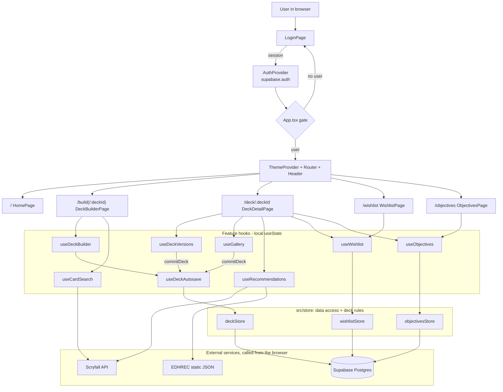

# Architecture overview

This page gives you a mental model of how MTG Deck Analyzer fits together, and why it is built the way it is.

## The big picture: a browser app with no server of its own

MTG Deck Analyzer is a single-page React app that runs entirely in the browser. It has no backend of its own, no API layer, and no server-side code. It talks to three outside services directly:

- **Supabase** (Postgres and Auth) holds everything a user owns: decks, objectives, and wishlist entries. The browser uses `@supabase/supabase-js` with the project's public anon key (`src/lib/supabase.ts`). Row-level security on the Supabase side is what keeps one user's data away from another's.
- **Scryfall's public REST API** (`api.scryfall.com`) supplies card data, search results, images, and prices. It is unauthenticated.
- **EDHREC's static JSON** (`json.edhrec.com`) feeds card suggestions. It is unofficial and undocumented, so it is isolated in one file, `src/features/recommendations/utils/edhrecClient.ts`.

Why no server? The app serves a handful of people. Supabase already provides a database, authentication, and per-user access rules. Scryfall and EDHREC are public and readable straight from the browser. A custom server would add hosting, deployment, and a second codebase without solving a problem the app actually has. The trade-off is that business rules live in client code, and every external call is made from the user's browser. That is why Scryfall's rate limits show up as client-side request spacing (see [External services](../reference/external-services.md)).

## Authentication is a single gate

Authentication is all-or-nothing, and it is decided once, at the top of the component tree.

`main.tsx` wraps the whole app in `AuthProvider` (`src/context/AuthContext.tsx`). The provider reads the current session with `supabase.auth.getSession()` and then keeps it current with `onAuthStateChange`. Until that first read finishes, `loading` is true.

`App.tsx` turns that state into three outcomes:

- While `loading`, it shows a full-screen spinner ("Shuffling up...").
- With no `user`, it renders `LoginPage` and nothing else.
- With a user, it mounts `ThemeProvider`, `BrowserRouter`, an `ErrorBoundary`, the global `Header`, and the routes.

There are six flat routes (`/`, `/build`, `/build/:deckId`, `/deck/:deckId`, `/wishlist`, `/objectives`), plus a catch-all that redirects to `/`. There is no nesting, no lazy loading, and no per-route auth check.

This design is deliberately blunt. Every screen in the app needs a signed-in user, so a per-route guard would only repeat the same check six times. Putting the gate above the router also means no page component ever has to handle a missing user.

One consequence is easy to miss. The loading screen and `LoginPage` render *above* `ThemeProvider`, so React hasn't applied the user's theme yet when they appear. A small script in `index.html` applies the saved theme before first paint, so these screens are themed anyway. That script mirrors `resolveInitialTheme()` in `ThemeContext.tsx`, and the two must stay in sync.

## Pages, feature hooks, and store modules

Data moves through three layers: pages, hooks, and store modules.

**Pages** (`src/pages/`) compose screens. They call feature hooks and pass the results down as props. `DeckDetailPage` is the busiest: it wires together `useDeckAutosave`, `useObjectives`, `useGallery`, `useDeckVersions`, `useWishlist`, and `useChartSelection`.

**Feature hooks** own state. Each one holds a slice of `useState`, fetches from a store module in a `useEffect` on mount, and exposes callbacks that change that state. Shared hooks live in `src/hooks/` (for example `useWishlist`, `useObjectives`, `useDeckAutosave`). Feature-specific hooks live next to their feature (for example `useDeckBuilder`, `useCardSearch`, `useDeckVersions`, `useGallery`, `useRecommendations`).

**Store modules** (`src/store/deckStore.ts`, `wishlistStore.ts`, `objectivesStore.ts`) talk to Supabase.

### Why "store" doesn't mean client state

The name is misleading if you come from Redux or Zustand. The app has no global state library. A store module is a plain object of `async` functions that map onto Supabase table operations, each with its own hand-written mapping between database rows and the app's domain types (see [Data model](../reference/data-model.md)). The modules hold no state between calls.

`deckStore.ts` is really two things in one file. One half is Supabase I/O. The other half is pure deck rules: adding cards, setting a commander, color-identity legality, duplicate checks, and import and export. When you read that file, keep the two halves separate in your head. The rules don't depend on the database at all.

### No shared cache, on purpose for now

Because state lives in per-page hooks, nothing survives navigation. Each page fetches what it needs when it mounts. For example, `HomePage`, `WishlistPage`, and `DeckDetailPage` each call `deckStore.getAll()` on their own. These fetches use a simple `mounted` flag rather than heavier race-guarding, which is enough for a single fetch on mount.

The cost is some redundant network traffic. The benefit is that there is no cache to invalidate, and every page always shows what is in the database. For a handful of users, that has been a reasonable trade. Consolidating the deck-list fetch into one shared hook is scoped in [`tasks/008`](../../tasks/008-reduce-redundant-deck-refetching.md).

The one place with real race handling is `useCardSearch`. It debounces input and cancels stale requests with an `AbortController`, because a fast typist can otherwise get results back out of order. `useRecommendations` also uses `AbortController`. Don't treat this as the house style for every fetch. Use it only where the same race actually exists.

## Two write conventions, and why each exists

Store mutations throw on any Supabase error. Read paths (`getAll`, `getById`, `getForDeck`) instead log and return `[]` or `undefined`, so a failed read shows an empty or "not found" state rather than crashing a page. Above that shared rule, writes follow one of two patterns. Which one applies depends on the shape of the data being written.

### Whole-deck writes: a serialized autosave queue

A deck is saved as a single row, and `deckStore.save` upserts the whole deck every time. That creates a specific hazard. If two saves are in flight at once, the older one can land second and overwrite the newer one.

`useDeckAutosave` (`src/hooks/useDeckAutosave.ts`) exists to prevent that. It chains saves on a promise queue so they run one at a time, in order. If a newer snapshot arrives while an older one is still waiting, the older one is skipped, because the newer one already contains its change. It exposes a `status` (`idle`, `saving`, `saved`, `error`) and a `retry`.

On failure, the hook leaves the local deck as it is, and it does not roll back. A rollback would be wrong here: a later save may already have written the same card, and every save rewrites everything anyway. The next save, or a retry, writes the full current deck.

On `DeckDetailPage`, every deck mutation goes through one function, `commitDeck`, which updates local state and queues an autosave. This covers gallery tagging, versions, quick add, and strategy. `useGallery` and `useDeckVersions` are pure: they compute the updated deck and hand it to `commitDeck`, and they never call `deckStore.save` themselves. `useDeckBuilder` uses the same autosave hook on the builder page. A second, independent `deckStore.save` on a page that already autosaves would bring back exactly the ordering bug the queue exists to prevent.

### Row-level writes: optimistic with rollback

Wishlist entries, objectives, and deck deletion are small, independent rows. Two writes to different rows can't clobber each other the way two whole-deck upserts can. So these use a simpler optimistic pattern:

1. Apply the change to local state immediately.
2. Await the store call.
3. On success, reconcile if needed (for example, swap a temporary wishlist entry for the real row). On failure, roll the local change back.

`useWishlist`, `useObjectives`, and `HomePage`'s deck delete all follow this pattern. On a failed delete, `HomePage` restores the deck and shows an error message. The UI feels instant, and a failure undoes itself instead of leaving a phantom change on screen. The background is in [`tasks/001`](../../tasks/001-fix-inconsistent-mutation-error-handling.md). For the practical side, see [Add a data write](../how-to/dev/add-a-data-write.md).

## Feature folders

Code specific to one area of the app lives under `src/features/<name>/`, split by role:

- `components/` holds the React components for that feature.
- `hooks/` holds the state-owning hooks.
- `utils/` holds pure helpers.

The features are `deckBuilder`, `deckList`, `deckVersions`, `gallery`, `metrics`, `objectives`, `recommendations`, `simulator`, and `wishlist`. Not every feature has all three folders, and `metrics` also has its own `context/` and `types/`.

Anything used across features sits at the top of `src/`: `components/` (for example `PageShell`, `Header`, `ConfirmDelete`, `ErrorBoundary`), `hooks/`, `context/`, `store/`, `types/`, and `utils/`.

The point of this layout is locality. When you work on suggestions, nearly everything you need is under `features/recommendations/`. The unofficial EDHREC dependency is contained there too, so if EDHREC changes shape, the damage stays in one folder.

The weak spot is that some cross-cutting concerns never got a shared home. Scryfall is called from several independent places (`useCardSearch`, `scryfallRecs.ts`, `CardPriceContext.tsx`, and `utils/utils.ts`) with no common client. Only the recommendations engine spaces its requests to respect Scryfall's rate limit. The price fetcher in `CardPriceContext.tsx` has its own simple batching delay. See [External services](../reference/external-services.md).

## Styling system

The app uses Tailwind v4 with daisyUI v5. Components are styled with daisyUI's **semantic tokens** (`base-100`, `base-200`, `base-300`, `base-content`, `primary`, `error`, and so on) rather than raw palette colors. This is what makes themes work: a theme only redefines what the tokens mean, so one component looks right in every theme without any per-theme code.

The theme is a single attribute. `ThemeProvider` (`src/context/ThemeContext.tsx`) stores the theme name in `localStorage` and sets `data-theme` on `<html>`. The theme picker in the header (`components/ThemeDropDown/ThemeDropdown.tsx`) offers a fixed list of themes. To add one, see [Add a daisyUI theme](../how-to/dev/add-a-theme.md).

Two custom **signature themes** are defined in `src/index.css`: `arcane` (dark, and the default) and `grimoire` (light). They lead the picker list. The display font, Cinzel (`font-display`), is reserved for the logo, page titles, and deck names. Keeping it off body copy keeps it reading as an accent.

**Mana colors are a deliberate exception.** `src/utils/manaColors.ts` holds fixed WUBRG hex values for decorative accents such as deck color strips. They do not follow the theme, because a mono-red deck should read as red in every theme, just as the mana symbols do. When something needs to mean "this is a Magic color," use the fixed hues. When it means "this is part of the interface," use a token.

Breakpoints, minimum text sizes, and the z-index scale are in [Design tokens](../reference/design-tokens.md).

## Deliberate scale limits

The app is a personal tool for a few people, and many of its "missing" pieces are missing on purpose. Knowing which ones helps you avoid over-building.

- **No state library, no query cache.** Per-page hooks and refetch-on-mount are enough at this scale. The only planned consolidation is the narrow shared deck-list hook in [`tasks/008`](../../tasks/008-reduce-redundant-deck-refetching.md), not a general caching layer.
- **No custom backend.** Supabase covers storage, auth, and access control. A server would mean a second deployment for no new capability.
- **No new design-token system.** daisyUI's tokens already provide theming. Cohesion problems (shell screens, page shells, header chrome, icons) are scoped as small fixes in [`tasks/002`](../../tasks/002-theme-aware-shell-screens.md) through [`tasks/005`](../../tasks/005-unify-icon-system.md), not a styling rewrite.
- **Careful growth in deck versions.** Versions are already the most elaborate subsystem, with their own hooks, utils, comparison UI, per-version objective overrides, and swap tracking. Before adding more, check [`tasks/007`](../../tasks/007-deck-version-editing-gaps.md), which records what is actually missing and asks for product-owner sign-off. Background is in [How deck versions work](how-deck-versions-work.md).
- **No test runner yet.** No test runner is configured. Standing one up is a planned, multi-phase effort in [`tasks/009`](../../tasks/009-testing-foundation-unit-and-acceptance.md), so ad hoc test tooling outside that plan would fragment it.
- **One objectives-tagging component, eventually.** Objectives tagging currently exists in more than one divergent implementation. A new one-off surface would make the consolidation in [`tasks/018`](../../tasks/018-shared-objectives-assignment-component.md) harder. For what objectives are and how they differ from Strategy and Card Roles, see [Strategy, Objectives, and Card Roles](strategy-objectives-and-card-roles.md).

The common thread is to weigh every new abstraction against the size of the audience. Something that would be essential in a public product is often just extra upkeep here.

## Related

- [Data model](../reference/data-model.md): the domain types and how they map to Supabase tables.
- [Add a data write](../how-to/dev/add-a-data-write.md): applying the two write conventions in practice.
- [Conventions and workflow](../contributing/conventions.md): code style, commit hooks, and where planning docs go.
